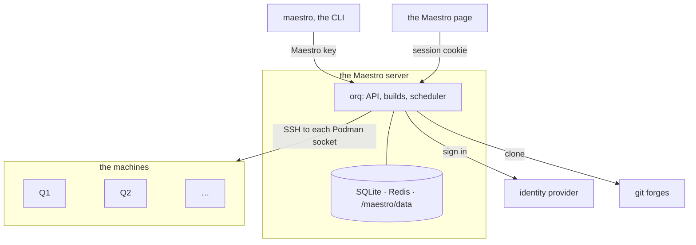
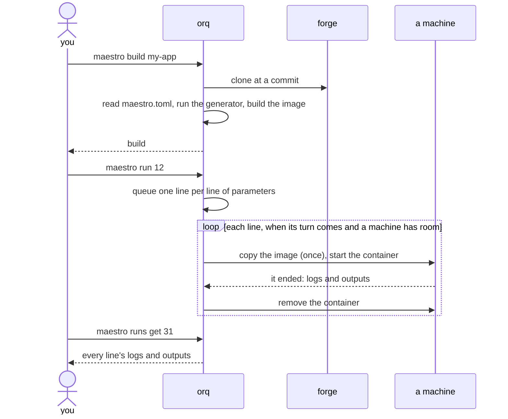

# The parts

Maestro is three programs and the machines they drive.

## orq, the server

orq makes every decision in Maestro. It signs people in through the lab's
identity provider, clones repositories with the forge tokens the CLI sends
it, and builds images with its own Podman. It records every build, run and
line in a SQLite database.

orq also runs the scheduler. The scheduler is a loop that picks which
waiting line goes to which machine, copies images to the machines, starts
containers, and collects what they leave.

Because everything about a run is in the database, orq can restart in the
middle of one and continue from where it stopped.

## The view

The view is the Maestro page, a web page served from the same host as orq.
It shows your runs and their files, the queue, your usage, and the admin
pages. It keeps no state of its own and asks orq for everything it shows.

## The CLI

The CLI is the `maestro` command, which does everything from a terminal. On
your computer it keeps the server's address, your Maestro key and your forge
tokens.

## The machines

A machine is a computer with Podman and an SSH server. It needs no Maestro
software. orq connects to each machine over SSH and talks to the machine's
Podman socket through that connection. It copies images to the machine,
starts containers, reads how loaded the machine is, and takes the logs and
outputs back when a container ends.

orq removes a container once it has the container's logs and outputs. The
image stays on the machine, so the next run of the same build starts
without copying it again.

## The life of a run

On a busy day a line spends most of this time waiting for its turn.
[The queue](queue.md) describes where it waits, and
[Policies and the score](score.md) describes how turns are decided.
