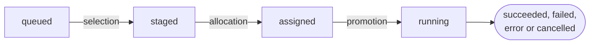

# The queue

The machines are shared, so a line usually waits before it runs. It waits
in three places in turn, and `maestro queue` shows how many lines are in
each.

```sh
maestro queue      # how many lines wait at each level, yours and everyone's
```

## The levels a line passes



A line moves through three waiting statuses, and a step of the scheduler
moves it from each one to the next.

| Status | Where the line is | What moves it on |
| --- | --- | --- |
| `queued` | Among your own lines | Selection stages it. |
| `staged` | Among the lines chosen from your group | Allocation gives it to a machine. |
| `assigned` | In the short queue of one machine | Promotion starts it. |
| `starting`, `running` | In a container on that machine | The program ends. |

### Selection: from queued to staged

`maestro run` queues every line of the run among your own lines. Each group
of users may have a limited number of lines staged at once, by default twice
the number of machines. While your group is under that limit, the scheduler
takes the next line of each of its users as a candidate and stages one of
them.

Two policies make that choice. The first picks which of your own lines is
your next. By default it is the oldest run first, line by line. The second
picks among the users' candidates. It can be as simple as the oldest, or it
can weigh how much of the machines each user already holds.

### Allocation: from staged to assigned

Groups take turns at the machines, one line a turn. In its turn, a group
gives one of its staged lines to a machine. The machine has to be one the
line may run on, by its [`machines`](../repo/maestro-toml.md#machines), and
it has to have room in its queue. Only three lines wait on each machine by
default. When several machines qualify, the scheduler draws one at random.
A group with no line that can go anywhere passes its turn.

While the line waits on the machine, the server copies the line's image
there if the machine doesn't have it yet.

### Promotion: from assigned to running

A machine starts a waiting line when the line's cores and memory fit in
what the machine has free. A fourth policy picks which of the lines waiting
on the machine starts first.

### Why the queues on machines are short

A machine holds only three waiting lines, so the scheduler decides whose
line goes next as late as it can. Someone who queues a single line behind
another user's thousand doesn't wait for the thousand, because nearly all
of those are still `queued` or `staged` when the single line arrives.

## Reading `maestro queue`

```text
      USER     GROUP  QUEUED  STAGED  ASSIGNED  STARTING  RUNNING  SHARE
    Ada #7  everyone      38       2         3         0        5    25%
  everyone               412       6         9         1       14

     GROUP  STAGED
  everyone     6/6

Lines are chosen by fifo among each group's users (fifo within each), given in turn between groups by fifo to a machine with room, drawn, and start by fifo on each machine.
```

The first row is yours and the `everyone` row is the total. `SHARE` is how
much of what all users hold is yours, as the scheduler measures it. The
second table shows your group, with how many of its lines are staged out of
how many it may have. `6/6` means the group is at its limit. The last line
names the four policies in force.

The Maestro page shows the same under Queue and reads it again every 5
seconds.

## Why a line is waiting

### Many lines queued and few staged

Your group is at its limit of staged lines, and the policy chose other
users' lines for the places it had. Under a policy that weighs shares, a
user who holds less of the machines than you goes first.

### Many lines staged

Either the machines' queues are full or it is another group's turn. A line
with `machines = [...]` waits for room on those machines only.

### A line assigned for a long time

The machine doesn't yet have the cores and memory the line asked for, or
the line's image is still being copied there. The copy happens only for the
first line of a build on each machine.

### A large line waits while smaller ones start

Most machine policies, such as `fifo-skip` and `best-fit`, choose among the
lines that fit in the free space now, so smaller lines go around a large one
that doesn't fit yet. Under `fifo`, which is the default, the oldest line
holds back the ones behind it until it fits.

`maestro top` shows how much of each machine lines are using and how many
lines wait there, as in `6/14 +3`.
[Watching the machines](../use/machines.md) explains the columns.

## Waiting less

- Ask for the cores and memory the program needs and no more. A line starts
  only where its `cpus` and `memory` fit, so a smaller line fits on more
  machines and sooner.
- Leave `machines` out unless the program needs particular hardware.
- Keep the image small. The first line of a build on each machine waits
  while the image is copied.

## When a machine goes away

A machine the server can't reach, over SSH or at its Podman socket, gets no
new lines. The lines that were waiting on it, or about to start there, go
back to `staged` so another machine can take them. They don't end in an
error. The server tries the machine again every 30 seconds.

Lines already running on the machine are left alone. The server checks on
them when the machine is back.

## The settings in force

```sh
maestro settings
```

`maestro settings` shows how the scheduler is set up: the four policies,
the weights of the score, and the limits above.
[Policies and the score](score.md) explains each of them.

Each line records the settings it was staged under and the group its user
was in. [`maestro export`](../use/usage.md#maestro-export) writes both, so
you can tell later how each line was served.
