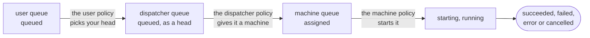
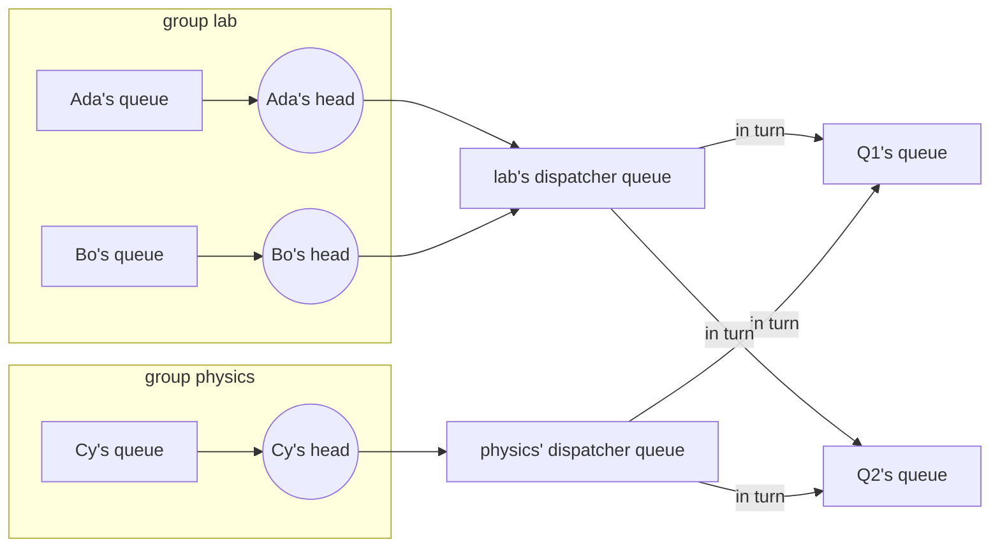

# The queue

The machines are shared, so a line usually waits before it runs. It waits
in three places in turn, and `maestro queue` shows how many lines are in
each.

```sh
maestro queue      # how many lines wait in each queue, yours and everyone's
```

## The three queues a line passes



A line waits in three queues in turn, and a policy picks who leaves each
one.

| Queue | Status | What is in it | What moves a line on |
| --- | --- | --- | --- |
| User queue | `queued` | Your own lines | The user policy picks your head. |
| Dispatcher queue | `queued` | The head of each user of your group | In your group's turn, the dispatcher policy gives one head a machine. |
| Machine queue | `assigned` | The lines given to one machine | The machine policy starts one when it fits. |
| | `starting`, `running` | A container on that machine | The program ends. |

A line in the dispatcher queue is still `queued`. Being a head isn't a
status: the scheduler works your head out again on every pass.

### The user queue: your head

`maestro run` puts every line of the run in your user queue. The user
policy puts your queued lines in an order, and the first of them is your
head. By default it is the oldest run first, line by line. With `lcfs` or
`pq`, a line you queue later can take your head's place.

A line that no machine could hold, even an empty one, is never your head.
It waits without holding back your other lines.

### The dispatcher queue: from queued to assigned



Each group has a dispatcher queue, made of the heads of its users and
nothing else. It has no size of its own: it holds one line for each user
who has lines waiting.

Groups take turns at the machines, one line a turn. In its turn, a group's
dispatcher policy picks one of its heads and gives it to a machine. The
machine has to be one the line may run on, by its
[`machines`](../repo/maestro-toml.md#machines), and it has to have room in
its queue. Only three lines wait on each machine by default. When several
machines qualify, the scheduler draws one at random. A group with no head
that can go anywhere passes its turn.

Your administrator may set a ceiling on the cores each user holds,
`user_max_cpus`. Your lines assigned, starting and running count toward
it, and your queued lines don't. While your head's cores, added to theirs,
would be over the ceiling, your head isn't a candidate. It stays in the
dispatcher queue, and the heads of other users go as usual. It goes once
enough of your lines end.

Once your head is given a machine, your next line is your head. The
dispatcher policy can be as simple as the oldest head, or it can weigh how
much of the machines each user already holds.

While the line waits on the machine, the server copies the line's image
there if the machine doesn't have it yet.

### The machine queue: from assigned to running

A machine starts a waiting line when the line's cores and memory fit in
what the machine has free. The machine policy picks which of the lines
waiting on the machine starts first.

### Why the queues on machines are short

A machine holds only three waiting lines, so the scheduler decides whose
line goes next as late as it can. Someone who queues a single line behind
another user's thousand doesn't wait for the thousand. Nearly all of those
are still in their user queue, and the single line is its user's head at
once.

## Reading `maestro queue`

```text
      USER     GROUP  QUEUED  HEADS  ASSIGNED  STARTING  RUNNING  SHARE
    Ada #7  everyone      38      1         3         0        5    25%
  everyone               412                9         1       14

     GROUP  QUEUED  HEADS  ASSIGNED
  everyone     412      6         9

Each user's head is chosen by fifo. In a group's turn, fifo picks one of its heads and gives it to a machine drawn among those with room. Lines start by fifo on each machine.
```

The first row is yours and the `everyone` row is the total. `HEADS` is how
many of the `QUEUED` lines are heads, in the dispatcher queue: yours is 1
while you have a line some machine could hold. `SHARE` is how much of what
all users hold is yours, as the scheduler measures it. The second table
shows your group: its queued lines, the heads among them, which make its
dispatcher queue, and its assigned lines. The last line names the three
policies in force.

When your next line waits because of the ceiling on cores, a sentence
before the last line says so:

```text
Your next line waits until some of yours end. With it, your lines assigned, starting and running would take more than 16 cores, the most a user may hold.
```

The Maestro page shows the same under Queue and reads it again every 5
seconds.

## Why a line is waiting

### Many lines queued

Only your head competes for a machine, and the dispatcher policy chose
other users' heads before it. Under a policy that weighs shares, a user who
holds less of the machines than you goes first. Your other lines wait their
turn behind your head.

### Your head waits in the dispatcher queue

Either the machines' queues are full or it is another group's turn. A line
with `machines = [...]` waits for room on those machines only.

### You hold the most cores a user may

With a ceiling on cores, your head waits while it would take you over it,
even when machines have room. `maestro queue` says so. `maestro settings`
shows the ceiling as "cores per user". Your head goes once enough of your
lines end. A line that asks for more cores than the ceiling never goes,
and while it is your head, your lines behind it wait too. Ask for fewer
with [`cpus`](../repo/maestro-toml.md#cpus-and-memory), or ask your
administrator to raise the ceiling.

### A line assigned for a long time

The machine doesn't yet have the cores and memory the line asked for, or
the line's image is still being copied there. The copy happens only for the
first line of a build on each machine.

### A large line waits while smaller ones start

Most machine policies, such as `fifo-skip` and `best-fit`, choose among the
lines that fit in the free space now, so smaller lines go around a large one
that doesn't fit yet. Under `fifo`, which is the default, the oldest line
holds back the ones behind it until it fits.

`maestro top` shows how much of each machine lines are using and how many
lines wait there, as in `6/14 +3`.
[Watching the machines](../use/machines.md) explains the columns.

## Waiting less

- Ask for the cores and memory the program needs and no more. A line starts
  only where its `cpus` and `memory` fit, so a smaller line fits on more
  machines and sooner.
- Leave `machines` out unless the program needs particular hardware.
- Keep the image small. The first line of a build on each machine waits
  while the image is copied.

## When a machine goes away

A machine the server can't reach, over SSH or at its Podman socket, gets no
new lines. The lines that were waiting on it, or about to start there, go
back to `queued`, in their place in their user's queue, so another machine
can take them. They don't end in an
error. The server tries the machine again every 30 seconds.

Lines already running on the machine are left alone. The server checks on
them when the machine is back.

## The settings in force

```sh
maestro settings
```

`maestro settings` shows how the scheduler is set up: the three policies,
the weights of the score, how many lines wait on a machine, and the most
cores a user may hold.
[Policies and the score](score.md) explains each of them.

Each line records the settings it was assigned under and the group its
user was in. [`maestro export`](../use/usage.md#maestro-export) writes both, so
you can tell later how each line was served.
